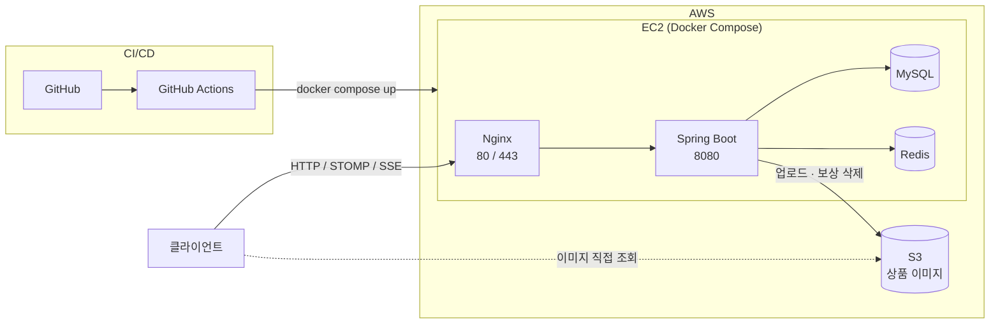
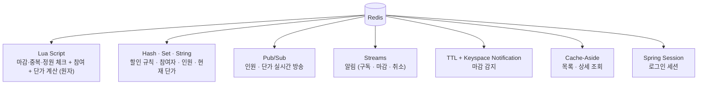
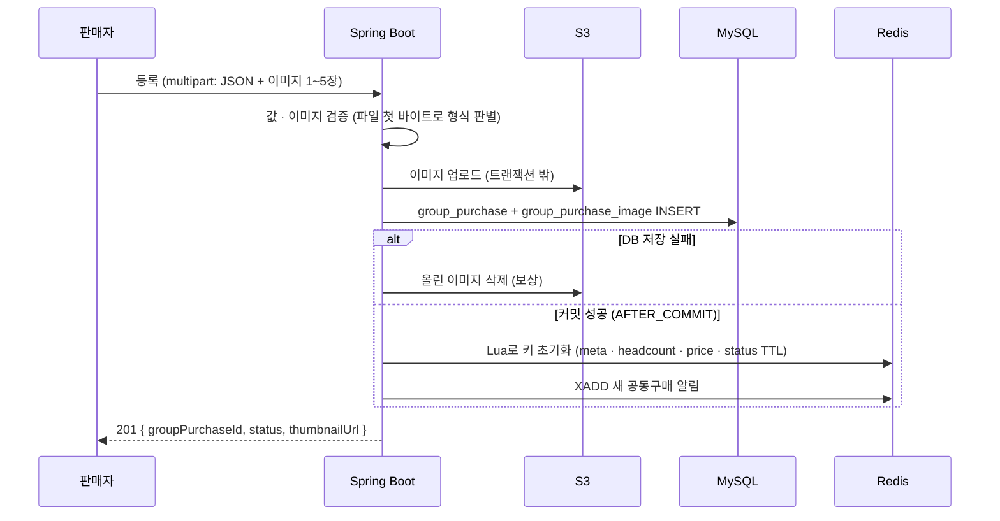
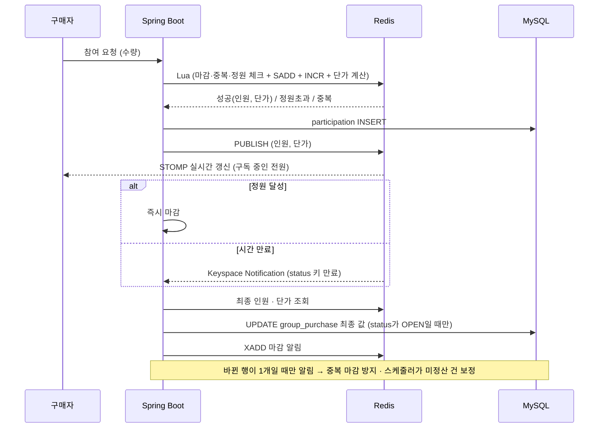
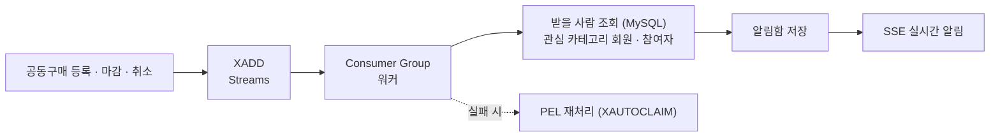

# TTUK (뚝)

**모일수록 가격이 뚝 떨어지는 공동구매 서비스**

---

## 한눈에 보기

| | |
|---|---|
| **무엇을** | 판매자가 상품과 할인 규칙을 올리면, 구매자가 모여 공동구매에 참여. 인원이 늘수록 단가가 내려가고 마감 시점 가격으로 전원 확정 |
| **왜** | 동시 참여 · 실시간 가격 변동 · 마감 정산을 **Redis**로 풀고, DB만 썼을 때와 **수치로 비교**하는 백엔드 중심 개인 프로젝트 |
| **핵심 포인트** | ① 선착순 참여 원자 처리 (Lua) ② 인원 → 단가 실시간 반영 ③ 마감 시 Redis → MySQL 정산 |
| **기간** | 2026.10 ~ 2026.12 (개인) |

> 대파 한 단 **3,000원** · 10명마다 5% 할인 → 10명 모이면 **2,850원** → 20명 모이면 **2,700원** … 하한가 **2,500원**

---

## 목차

1. [목표](#목표)
2. [기술 스택](#기술-스택)
3. [기술 선택 이유](#기술-선택-이유)
4. [전체 구조](#전체-구조)
5. [핵심 흐름](#핵심-흐름)
6. [ERD](#erd)
7. [주요 기능](#주요-기능)
8. [성능 · 정합성 비교](#성능--정합성-비교)
9. [이슈와 해결 과정](#이슈와-해결-과정)
10. [고민한 부분 / 한계](#고민한-부분--한계)

---

## 기술 스택

| 구분 | 기술 |
|---|---|
| **Backend** | Java 21 · Spring Boot 4.1 · Spring Data JPA · Querydsl · Gradle |
| **Database** | MySQL 8 |
| **Cache / Messaging** | Redis — Lua Script · Hash · Set · Streams · Pub/Sub · Keyspace Notification · Spring Session |
| **Realtime** | STOMP (WebSocket) · SSE |
| **Storage** | AWS S3 (AWS SDK for Java v2) |
| **Infra** | AWS EC2 · Docker Compose · Nginx |
| **CI/CD** | GitHub Actions |
| **Test** | JUnit 5 · Testcontainers (MySQL · Redis · LocalStack) · k6 |

---

## 기술 선택 이유

### JPA + Querydsl (vs MyBatis, JPQL 문자열)

| 기준 | MyBatis | JPQL 문자열 (`@Query`) | **JPA + Querydsl** |
|---|---|---|---|
| 기본 CRUD | SQL·매핑을 매번 작성 | 리포지토리가 자동 제공 | 리포지토리가 자동 제공 |
| 수정 | `UPDATE` 직접 작성 | 변경 감지 | **변경 감지** + `@DynamicUpdate`로 바뀐 컬럼만 |
| 동적 조건 (카테고리·상태·정렬·페이지) | XML `<if>`로 조합 | 문자열 이어 붙이기 | **자바 코드로 조합** (`BooleanExpression`) |
| 오타·필드명 변경 | 실행해야 발견 | 실행해야 발견 | **컴파일 단계에서 발견** (Q클래스) |
| 연관관계 | 결과를 손으로 매핑 | 엔티티 그래프 | 엔티티 그래프 + fetch join |
| SQL 통제 | **가장 세밀함** | 중간 | 중간 (생성 SQL 확인 필요) |

**선택 이유**
- 이 프로젝트의 핵심은 SQL 튜닝보다 **Redis와의 역할 분담**이라, 회원·카테고리·공동구매 같은 기본 CRUD는 리포지토리와 변경 감지로 줄이고 핵심 로직에 집중
- 목록 조회는 카테고리·상태·정렬·페이지가 **조건마다 붙었다 빠졌다** 하는 동적 쿼리 → Querydsl로 타입 안전하게 조합
- 엔티티 필드명을 바꾸면 Q클래스가 다시 생성되면서 **틀린 쿼리가 컴파일 에러**로 드러남
- 회사에서는 MyBatis를 쓰고 있어, 개인 프로젝트는 일부러 JPA로 해서 **두 방식을 실제로 비교**

### MySQL (vs PostgreSQL)

| 기준 | PostgreSQL | **MySQL 8 (InnoDB)** |
|---|---|---|
| 강점 | JSONB·배열 같은 풍부한 타입, 복잡한 분석 쿼리, 엄격한 표준 준수 | **단순한 OLTP(짧은 읽기·쓰기)**에 최적화, 운영 사례·자료가 많음 |
| 기본 키 저장 구조 | 힙 테이블 + 별도 인덱스 | **PK 클러스터드 인덱스** (PK 순서로 데이터 저장) |
| 국내 서비스·채용 | 늘어나는 추세 | **가장 널리 쓰임** |
| AWS | RDS 지원 | RDS 지원 |
| 이 프로젝트에 필요한 기능 | (JSON·분석 기능은 쓰지 않음) | 트랜잭션, FK, UNIQUE, 인덱스면 충분 |

**선택 이유**
- DB 작업이 **짧은 INSERT·UPDATE와 PK·인덱스 조회**가 대부분 → MySQL이 가장 잘하는 형태
- `id BIGINT AUTO_INCREMENT` + **클러스터드 인덱스**라 참여·알림처럼 쌓이는 데이터가 PK 순서대로 뒤에 붙어 INSERT가 빠름
- 자주 바뀌는 인원·단가는 Redis가 맡고 MySQL은 **기록과 조회**만 담당 → PostgreSQL의 고급 기능을 쓸 일이 없음
- 국내에서 가장 많이 쓰는 DB라 실무 감각과 연결되고, InnoDB 구조(버퍼 풀, 리두 로그, 인덱스)를 직접 적용·검증

### Gradle (vs Maven)

| 기준 | Maven | **Gradle (Groovy DSL)** |
|---|---|---|
| 설정 파일 | `pom.xml` (XML, 장황) | `build.gradle` (**짧고 읽기 쉬움**) |
| 빌드 속도 | 매번 전체 단계 실행 | **증분 빌드 + 빌드 캐시 + 데몬** — 바뀐 것만 다시 빌드 |
| 커스텀 작업 | 플러그인 작성 필요 | 스크립트로 바로 작성 (예: Querydsl 생성 경로) |
| 표준화 | **구조가 엄격해 예측 가능** | 자유도가 높아 사람마다 다르게 쓸 수 있음 |
| 스프링 | 지원 | **Spring Initializr 기본값**, 스프링 부트 자체도 Gradle로 빌드 |

**선택 이유**
- Testcontainers 통합 테스트를 자주 돌리는 프로젝트라 **증분 빌드·캐시로 반복 빌드가 빠른** 게 중요
- 의존성 추가가 한 줄이라 Querydsl·AWS SDK BOM·Testcontainers 설정이 짧고 한눈에 보임
- 회사는 Maven이라, 개인 프로젝트는 Gradle로 **두 빌드 도구를 모두 다뤄 보기** 위함

### GitHub Actions (vs Jenkins)

| 기준 | Jenkins | **GitHub Actions** |
|---|---|---|
| 설치·운영 | **Jenkins 서버를 직접 띄우고 관리** (업데이트·플러그인·보안) | 서버 불필요 (GitHub이 실행 환경 제공) |
| 설정 | 웹 UI 또는 Jenkinsfile | 레포 안 `.github/workflows/*.yml` — **코드와 같이 버전 관리** |
| PR 연동 | 웹훅·플러그인 설정 필요 | **PR마다 자동 실행, 결과가 PR 화면에 바로 표시** |
| 비밀 값 | Credentials 플러그인 | 레포 **Secrets** (LocalStack 토큰, 배포 키 등) |
| 유연성 | **플러그인 생태계가 가장 큼**, 사내망·대규모 파이프라인에 강함 | 마켓플레이스 액션, 대부분의 경우 충분 |
| 비용 | 서버 비용 | 공개 레포는 무료 한도 넉넉 |

**선택 이유**
- 개인 프로젝트에서 EC2 한 대에 **Jenkins까지 올리면 메모리·관리 부담**이 앱보다 커짐
- 코드가 GitHub에 있고 **PR 단위로 멘토 리뷰**를 받는 흐름이라, PR마다 테스트·정적 분석 결과가 바로 붙는 게 리뷰에 유리
- 워크플로가 레포 안 파일이라 **배포 방식 변경도 PR로 리뷰** 가능

### S3 (vs 로컬 디스크 · DB BLOB · Cloudflare R2)

| 기준 | 로컬 디스크 / Docker 볼륨 | DB BLOB | Cloudflare R2 | **S3** |
|---|---|---|---|---|
| 재배포해도 유지 | 볼륨이면 유지 | ✅ | ✅ | ✅ |
| 서버 2대가 공유 | ❌ 한 서버에 묶임 | ✅ | ✅ | ✅ |
| DB 부담 | 없음 | **DB 비대·백업 느림·조회 부하** | 없음 | 없음 |
| 비용 | 디스크 | DB 저장 비용(비쌈) | 저장 저렴, **전송 요금 없음** | 저장·요청 저렴, 전송 요금 있음 |
| EC2와 연동 | - | - | 별도 키 관리 | **IAM Role로 키 없이 접근** |
| 테스트 | - | - | S3 호환 API | **LocalStack**으로 같은 API 테스트 |

**선택 이유**
- 서버와 저장소가 분리돼 **재배포·증설해도 이미지가 그대로**
- 같은 AWS라 EC2에 **IAM Role**만 붙이면 코드·설정에 액세스 키를 둘 필요가 없음 (로컬은 AWS CLI 프로필, 권한은 `images/*` 업로드·삭제만)
- S3 API가 사실상 표준이라 LocalStack으로 진짜와 같은 코드로 테스트하고, 필요하면 R2·MinIO로 옮기기도 쉬움
- DB엔 **S3 키만** 저장 → CloudFront 도입 등 주소가 바뀌어도 설정 한 줄만 변경

---

## 전체 구조

### Redis 역할

### 데이터 저장 분리

| 저장소 | 역할 |
|---|---|
| **Redis** | 진행 중인 공동구매의 참여자 · 인원 · 현재 단가 · 할인 규칙 사본 (빠르게 변하는 상태), 로그인 세션 |
| **MySQL** | 회원, 공동구매 등록 정보, 참여 이력, **마감 후 확정된** 최종 인원 · 단가, 알림함 |
| **S3** | 상품 이미지 파일 (DB에는 S3 키만 저장, URL은 응답 때 조합) |

---

## 핵심 흐름

### 등록 → Redis 초기화 → 알림

### 참여 → 마감 → 정산

### 알림

---

## ERD

[dbdiagram →](https://dbdiagram.io/d/ttuk-6add7c04aac3301410110c0a)

| 테이블 | 역할 |
|---|---|
| member | 회원 (구매자 · 판매자) |
| category | 상품 종류 (시드 8개) |
| member_category | 구매자 관심 카테고리 (member ↔ category) |
| group_purchase | 공동구매 본체 · 할인 규칙 · 마감/취소 시점 최종 값 |
| group_purchase_image | 상품 이미지 S3 키 (1~5장, sort_order 0이 대표) |
| participation | 참여 기록 (취소 이력 포함) · 마감 후 JOINED 참여 = 주문 |
| notification | 알림함 (stream_message_id로 중복 저장 방지) |

---

## 주요 기능

<table>
<tr>
<th width="33%">판매자</th>
<th width="33%">구매자</th>
<th width="33%">시스템</th>
</tr>
<tr>
<td valign="top">

- 카테고리 선택 후 공동구매 등록
  - 기본가 · 하한가 · 할인 규칙 (몇 명마다 몇 % / 몇 원)
  - 정원(제한/무제한) · 마감 시각 · 이미지 1~5장
- 등록 즉시 관심 카테고리 회원에게 알림
- 내 판매 목록 · 판매 상세 (참여자 명단)
- 공동구매 취소 (사유 입력 → 참여자 알림)

</td>
<td valign="top">

- 관심 카테고리 등록 · 알림 수신
- 목록 · 상세 조회
  (현재 인원 · 현재 단가 · 다음 할인까지 남은 인원)
- 참여 / 취소 (마감 1시간 전까지), 취소 후 재참여
- 내 참여 내역 · 확정 금액
- 알림함 (읽음 · 전체 읽음)

</td>
<td valign="top">

- 선착순 참여 원자 처리
- 인원 변동 시 실시간 단가 방송
- 정원 달성 / 시간 만료 자동 마감
- 마감 시 MySQL에 최종 인원 · 단가 확정
- 목록 · 상세 캐시 및 갱신
- 이미지 업로드 실패 시 S3 보상 삭제

</td>
</tr>
</table>

---

## 성능 · 정합성 비교

> k6 — 동시 사용자 N명이 정원 M명 공동구매에 참여하는 시나리오

| 항목 | DB 비관적 락 | Redisson 분산락 | Redis Lua |
|---|:---:|:---:|:---:|
| TPS | - | - | - |
| 평균 응답시간 | - | - | - |
| p99 응답시간 | - | - | - |
| 초과 참여 건수 | - | - | - |

_결과 그래프 첨부 예정_

---

## 이슈와 해결 과정

> 개발하며 부딪힌 문제를 정리합니다. 자세한 과정은 블로그에 기록했습니다.

| 문제 | 원인 | 해결 |
|---|---|---|
| 커밋 전에 Redis를 쓰면, DB 롤백 시 Redis에 유령 키가 남음 | 서비스 안에서 바로 Redis 호출 | 이벤트 발행 + `@TransactionalEventListener(AFTER_COMMIT)` |
| 커밋 후 리스너 예외가 500으로 올라가 판매자가 중복 등록할 수 있음 | AFTER_COMMIT 예외가 호출한 쪽까지 전파됨 | 리스너에서 예외를 잡고 로그, 누락분은 보정 스케줄러로 재초기화(멱등 Lua) |
| S3 업로드 동안 DB 커넥션을 붙잡음 | 등록 메서드 전체가 `@Transactional` | 업로드는 트랜잭션 밖, DB 저장만 `TransactionTemplate`으로 짧게 (private 메서드 `@Transactional`은 자기 호출로 무시됨) |
| DB 저장 실패 시 S3에 고아 파일이 남음 | S3는 롤백이 없음 | 업로드한 키를 모아 두고 실패 시 `DeleteObjects`로 보상 삭제 |
| 이름·Content-Type만 바꾼 위조 파일이 통과 | 클라이언트가 보낸 값을 신뢰 | 파일 첫 바이트(매직 넘버)로 형식 판별, 저장 Content-Type은 서버가 지정 |
| 테스트용 가짜 S3(LocalStack)가 어느 날부터 안 뜸 | 2026년 3월부터 LocalStack 이미지가 인증 토큰 요구 | 무료 토큰을 환경 변수 · GitHub Secret으로 관리, 이미지 버전 고정 |

---

## 고민한 부분 / 한계

- **이미지 공개 방식** — 지금은 버킷 정책으로 `images/*`만 읽기 공개. 실무 표준은 비공개 버킷 + CloudFront OAC(캐시 · HTTPS · 핫링킹 차단). DB에 키만 저장해 전환 시 설정만 변경
- **업로드 경로** — 서버를 거치는 multipart 방식. 트래픽이 커지면 Presigned URL(브라우저 → S3 직접 업로드)로 서버 부하 제거 가능, 대신 서버의 파일 검사가 어려워짐
- **고아 파일** — 보상 삭제도 실패하거나 서버가 중간에 죽으면 S3에 파일이 남음 → "DB에 없는 키 중 하루 지난 것"을 지우는 정리 배치(2차)
- **알림 유실** — XADD 자체가 실패하면 그 알림은 되살릴 수 없음. 정석은 Outbox 패턴(같은 트랜잭션으로 보낼 알림을 DB에 저장)
- **Streams 길이** — `MAXLEN ~ 10000`이라 워커가 오래 죽어 미처리 메시지가 1만 개를 넘으면 오래된 것부터 잘림
- **자격 증명** — 로컬은 IAM 사용자 장기 키(최소 권한), 운영 EC2는 IAM Role. 더 안전한 IAM Identity Center(SSO) 임시 자격 증명은 개인 프로젝트 규모상 보류
- **Redis Cluster 확장** — Lua가 쓰는 키는 같은 슬롯이어야 함 → 확장 시 키에 해시 태그(`group_purchase:{id}:...`) 적용 필요
- **악성 파일 완전 차단** — 첫 바이트 검사만으로는 한계 → 이미지 디코딩 · 백신 검사 연동 검토

---
