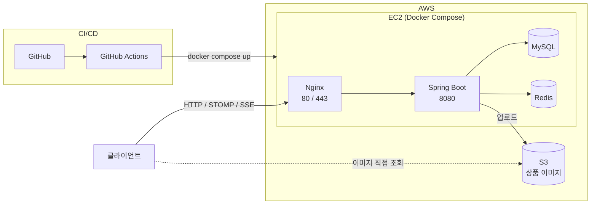
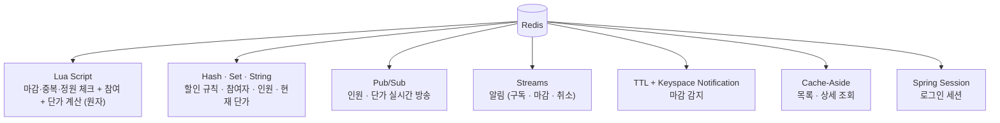
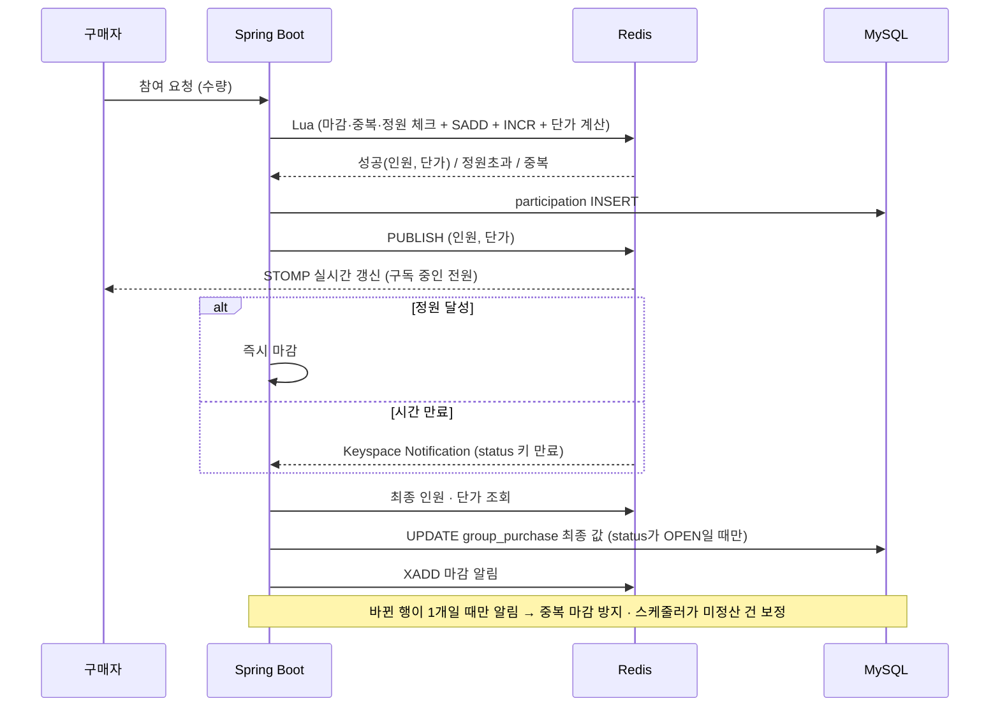
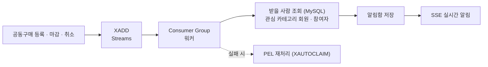

# TTUK (뚝)

**모일수록 가격이 뚝 떨어지는 공동구매 서비스**

---

## 한눈에 보기

| | |
|---|---|
| **무엇을** | 판매자가 상품과 할인 규칙을 올리면, 구매자가 모여 공동구매에 참여. 인원이 늘수록 단가가 내려가고 마감 시점 가격으로 전원 확정 |
| **왜** | 동시 참여 · 실시간 가격 변동 · 마감 정산을 **Redis**로 풀고, DB만 썼을 때와 **수치로 비교**하는 백엔드 중심 개인 프로젝트 |
| **핵심 포인트** | ① 선착순 참여 원자 처리 (Lua) ② 인원 → 단가 실시간 반영 ③ 마감 시 Redis → MySQL 정산 |
| **기간** | 2026.10 ~ 2026.12 (개인) |

> 대파 한 단 **3,000원** · 10명마다 5% 할인 → 10명 모이면 **2,850원** → 20명 모이면 **2,700원** … 하한가 **2,500원**

---

## 목차

1. [목표](#목표)
2. [기술 스택](#기술-스택)
3. [전체 구조](#전체-구조)
4. [핵심 흐름](#핵심-흐름)
5. [ERD](#erd)
6. [주요 기능](#주요-기능)
7. [성능 · 정합성 비교](#성능--정합성-비교)
8. [이슈와 해결 과정](#이슈와-해결-과정)
9. [고민한 부분 / 한계](#고민한-부분--한계)
10. [실행 방법](#실행-방법)

---

## 목표

| # | 목표 | 어떻게 |
|---|---|---|
| 1 | **동시성 제어** — 수천 명 동시 참여에도 초과 참여 0건 | DB 비관적 락 / Redisson 분산락 / Redis Lua 를 같은 조건에서 k6 비교 |
| 2 | **실시간 가격 반영** — 인원 변동 즉시 구독자에게 전달 | Lua에서 할인 규칙으로 단가 계산 + Pub/Sub → STOMP |
| 3 | **마감 정산 정합성** — 정원 달성 · 시간 만료 두 조건 모두 누락 없이 저장 | TTL + Keyspace Notification + 스케줄러 보정 |
| 4 | **알림 유실 방지** — 구독 · 마감 · 취소 알림 재처리 | Redis Streams + Consumer Group |
| 5 | **배포 자동화** | GitHub Actions → EC2 Docker Compose |

---

## 기술 스택

| 구분 | 기술 |
|---|---|
| **Backend** | Java 21 · Spring Boot 3.x · Spring Data JPA · Querydsl |
| **Database** | MySQL 8 |
| **Cache / Messaging** | Redis — Lua Script · Hash · Set · Streams · Pub/Sub · Keyspace Notification · Spring Session |
| **Realtime** | STOMP (WebSocket) · SSE |
| **Infra** | AWS EC2 · S3 · Docker Compose · Nginx |
| **CI/CD** | GitHub Actions |
| **Test** | JUnit 5 · Testcontainers · k6 |

---

## 전체 구조

### Redis 역할

### 데이터 저장 분리

| 저장소 | 역할 |
|---|---|
| **Redis** | 진행 중인 공동구매의 참여자 · 인원 · 현재 단가 · 할인 규칙 사본 (빠르게 변하는 상태), 로그인 세션 |
| **MySQL** | 회원, 공동구매 등록 정보, 참여 이력, **마감 후 확정된** 최종 인원 · 단가, 알림함 |
| **S3** | 상품 이미지 파일 (DB에는 URL만 저장) |

---

## 핵심 흐름

### 참여 → 마감 → 정산

### 알림

---

## ERD

**[dbdiagram에서 보기 →](https://dbdiagram.io/d/ttuk-6add7c04aac3301410110c0a)**

| 테이블 | 역할 |
|---|---|
| member | 회원 (구매자 · 판매자) |
| category | 상품 종류 (야채 · 과일 · 생선 · 가전 …) |
| member_category | 회원 관심 카테고리 (member ↔ category 매핑) |
| group_purchase | 공동구매 본체 · 할인 규칙 · 마감/취소 시점 최종 값 |
| group_purchase_image | 상품 이미지 URL (최대 5장) |
| participation | 참여 기록 (취소 이력 포함) · 마감 후 JOINED 참여 = 주문 |
| notification | 알림함 |

---

## 주요 기능

<table>
<tr>
<th width="33%">판매자</th>
<th width="33%">구매자</th>
<th width="33%">시스템</th>
</tr>
<tr>
<td valign="top">

- 카테고리 선택 후 공동구매 등록
  - 기본가 · 하한가 · 할인 규칙 (몇 명마다 몇 % / 몇 원)
  - 정원(제한/무제한) · 마감 시각 · 이미지 1~5장
- 등록 즉시 관심 카테고리 회원에게 알림
- 내 판매 목록 · 판매 상세 (참여자 명단)
- 공동구매 취소 (사유 입력 → 참여자 알림)

</td>
<td valign="top">

- 관심 카테고리 등록 · 알림 수신
- 목록 · 상세 조회
  (현재 인원 · 현재 단가 · 다음 할인까지 남은 인원)
- 참여 / 취소 (마감 1시간 전까지), 취소 후 재참여
- 내 참여 내역 · 확정 금액
- 알림함 (읽음 · 전체 읽음)

</td>
<td valign="top">

- 선착순 참여 원자 처리
- 인원 변동 시 실시간 단가 방송
- 정원 달성 / 시간 만료 자동 마감
- 마감 시 MySQL에 최종 인원 · 단가 확정
- 목록 · 상세 캐시 및 갱신

</td>
</tr>
</table>

---

## 성능 · 정합성 비교

> k6 — 동시 사용자 N명이 정원 M명 공동구매에 참여하는 시나리오

| 항목 | DB 비관적 락 | Redisson 분산락 | Redis Lua |
|---|:---:|:---:|:---:|
| TPS | - | - | - |
| 평균 응답시간 | - | - | - |
| p99 응답시간 | - | - | - |
| 초과 참여 건수 | - | - | - |

_결과 그래프 첨부 예정_

---

## 이슈와 해결 과정

> 개발 진행하며 정리

